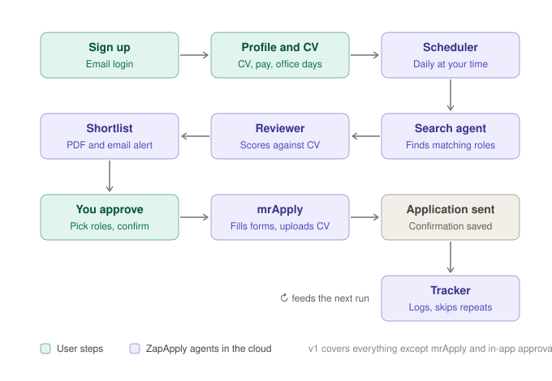

# ZapApply

ZapApply searches for jobs every morning, scores each role against your CV, and emails you a shortlist with direct links to apply.



## What's in v1

| Part | What it does | Where |
|---|---|---|
| Sign in | Email magic link, no passwords | `app/login`, `app/auth` |
| Profile | CV upload (PDF), job titles, locations, max office days, permanent/contract, salary and day rate, notice period, right to work, run time | `app/profile` |
| Search agent | Claude with web search finds live adverts that match the profile, skipping anything already seen | `lib/agents/search.ts` |
| Reviewer | A separate Claude call scores each role against the CV out of 100; under 65 is dropped, 85+ is "Very suitable" | `lib/agents/review.ts` |
| Shortlist | Roles saved per user; PDF with clickable Apply links emailed out; shortlist page in the app | `lib/pdf.ts`, `lib/email.ts`, `app/shortlist` |
| Scheduler | GitHub Actions runs hourly and processes each user at their chosen UK hour | `.github/workflows/daily-run.yml`, `lib/pipeline.ts` |
| Your data | CVs in a private bucket; row level security so users only see their own data; account deletion removes everything | `supabase/migrations/0001_init.sql` |

Coming next: in-app approval of roles, then **mrApply** (Playwright in a cloud browser) to fill in applications on Greenhouse, Lever, Ashby and Workable, with the user confirming each submission.

## Setup checklist

You need four free accounts. Keep every key out of the code; they only go in the places listed below.

1. **Supabase** (database, login, CV storage): create a project at supabase.com.
   - SQL Editor → paste and run `supabase/migrations/0001_init.sql`.
   - Authentication → URL Configuration → set Site URL to your Vercel URL and add `https://YOUR-SITE/auth/callback` as a redirect URL.
   - Project Settings → API → copy the project URL, the `anon` key and the `service_role` key.
2. **Anthropic**: create an API key at console.anthropic.com and set a monthly spend limit.
3. **Resend** (email): create an API key and verify the domain you'll send from.
4. **Vercel** (website): import this repo, then add these environment variables:
   `NEXT_PUBLIC_SUPABASE_URL`, `NEXT_PUBLIC_SUPABASE_ANON_KEY`, `SUPABASE_SERVICE_ROLE_KEY`, `NEXT_PUBLIC_SITE_URL`.
5. **GitHub** (daily run): in this repo go to Settings → Secrets and variables → Actions.
   - Secrets: `NEXT_PUBLIC_SUPABASE_URL`, `SUPABASE_SERVICE_ROLE_KEY`, `ANTHROPIC_API_KEY`, `RESEND_API_KEY`, `EMAIL_FROM`
   - Variables: `NEXT_PUBLIC_SITE_URL`, and optionally `ANTHROPIC_MODEL` (defaults to `claude-sonnet-5-5`)

Then sign up on your site, fill in your profile, and run the workflow by hand from the Actions tab (Daily run → Run workflow) to get your first shortlist.

## Run it locally

```bash
cp .env.example .env.local   # fill in the values
npm install
npm run dev                  # website on http://localhost:3000
npm run daily-run            # runs the agents for anyone who is due now
```

## Why the agents run in GitHub Actions

A search with web browsing and a review can take a few minutes per user, which is longer than a typical serverless function is allowed to run. GitHub Actions gives each run up to 50 minutes and is free for this volume. The website itself stays on Vercel.

## Costs to watch

Each run makes a few Claude API calls per user (one search with up to 15 web searches, one review, and a one-off CV read). Set a spend limit in the Anthropic console, and check the `runs` table to see how each run went.
